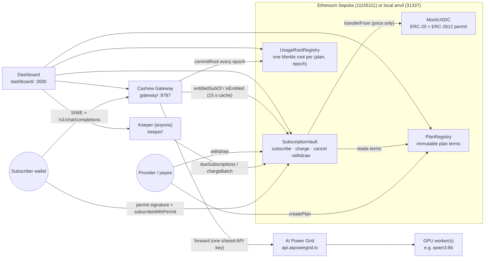
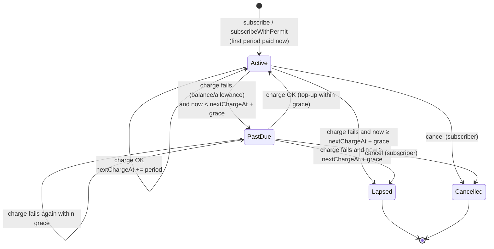
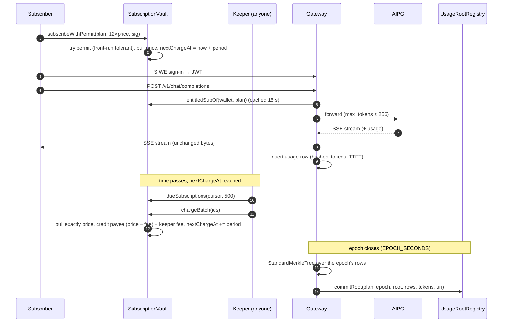
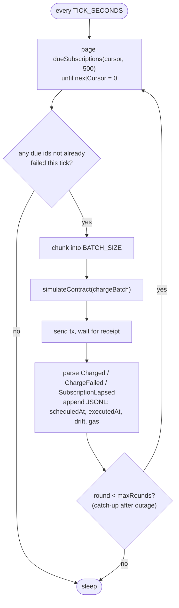

# Chapter 4 — System Architecture

Cashew has four on-chain contracts and three off-chain services. **The contracts hold all value and enforce every payment rule.** The off-chain services hold no user funds: they only trigger permitted actions (keeper), meter usage (gateway), or display state (dashboard). The diagrams in this chapter are adapted from `docs/ARCHITECTURE.md`.

## 4.1 Components



*Figure 4.1 — Components and data flow. The original specification targeted Base Sepolia; the deployed testnet is Ethereum Sepolia (deviation D20, Appendix B).*

| Component | Code | Role |
|---|---|---|
| `MockUSDC` | `contracts/src/MockUSDC.sol` | 6-decimal settlement token with ERC-2612 `permit` and an open faucet (`mint`, capped at 1,000 mUSDC per call). |
| `PlanRegistry` | `contracts/src/PlanRegistry.sol` | Providers publish plans. Price, period, grace, token and payee have no setter. `active` gates only new subscriptions. |
| `SubscriptionVault` | `contracts/src/SubscriptionVault.sol` | Holds subscriptions and claimable balances. Anyone may call `charge`. The vault decides the amount (always `price`) and the timing (anchored schedule). |
| `UsageRootRegistry` | `contracts/src/UsageRootRegistry.sol` | Allow-listed committers post one Merkle root per (plan, epoch). Anyone can verify a row. `hashRow` recomputes the leaf on-chain. |
| Keeper | `keeper/` | Polls `dueSubscriptions`, sends `chargeBatch`, logs JSONL, serves `/health` on :8788. Stateless and permissionless; many can run at once. |
| Gateway | `gateway/` | SIWE auth, `csk_` API keys, entitlement gate (402), policy (model allowlist, `max_tokens` cap, rate limit, live budget), AIPG proxy (mock/live), SQLite metering, epoch roots, proof API. |
| Dashboard | `dashboard/` | Next.js UI: overview, provider, plan/subscribe, chat, activity, attack panel, epoch verifier. |
| Shared | `packages/shared/` | Generated ABIs and `addresses.json` keyed by chain id. The only place addresses live. |

## 4.2 Subscription state machine



*Figure 4.2 — Subscription states. `None` (status 0) is the default for an unknown id. Lapsed and Cancelled are terminal; the subscriber may then open a new subscription (`test_ResubscribeAfterCancel`, `test_ResubscribeAfterLapse`).*

Entitlement is computed from state on every read:

```
isEntitled = (Active or PastDue) and now < nextChargeAt + grace
          or  Cancelled          and now < nextChargeAt        (paid-through, no grace)
```

## 4.3 One period, end to end



*Figure 4.3 — Sequence for one billing period.*

## 4.4 Keeper loop



*Figure 4.4 — Keeper loop. A keeper that was offline re-scans within the same tick (up to `maxRounds`, default 16, in `keeper/src/keeper.ts`). Each charge settles exactly one period, so a subscription k periods behind is charged k times, one period per call, never `k × price` in one call.*

## 4.5 Trust assumptions

| Party | Trusted for | Not trusted for (enforced on-chain) |
|---|---|---|
| Keeper | Liveness only. If no keeper runs, charges are late, not lost (and unfunded subscriptions lapse). | Amount, timing, recipient. It cannot charge early, twice, after cancel, more than `price`, or redirect funds. |
| Gateway | Correct metering and honest root commitments. Gating access to its own AIPG key. | Payments. It cannot move funds. Roots only bind the gateway to what it recorded. |
| Provider | Delivering the service behind the plan. | Changing price/period/payee after subscribers enrol. It can only close the plan to new subscribers. |
| Subscriber | Keeping balance and allowance if they want service. | Nothing else. They can cancel at any time and keep access until paid-through. |
| Token | Standard ERC-20 behaviour. | `SafeERC20` handles non-standard return values. Fee-on-transfer tokens are not supported. |

*Source: `docs/ARCHITECTURE.md`, "Trust assumptions".*

## 4.6 Deployment views

- **Local:** `pnpm local:up` starts anvil (1 s blocks), deploys and seeds the contracts, syncs ABIs, and starts the keeper, the gateway in mock mode and the dashboard. All Chapter 9 experiments except the grid snapshot run against anvil.
- **Testnet:** the four contracts are deployed and Etherscan-verified on **Ethereum Sepolia** (Appendix D). `pnpm testnet:up` runs the keeper, gateway and dashboard against Sepolia. The gateway's AIPG mode (`mock` or `live`) is set in `gateway/.env`.

The project seeds two plans (`Seed.s.sol`, `docs/REPORT_NOTES.md` §7): a **demo plan** (#1: 20 mUSDC, 180 s period, 60 s grace) so a full cycle fits in a live presentation, and a **production-shaped plan** (#2: 20 mUSDC, 30 days, 3 days grace).
