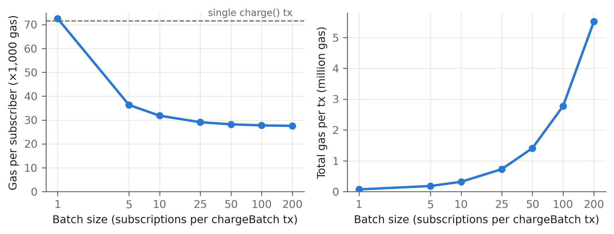
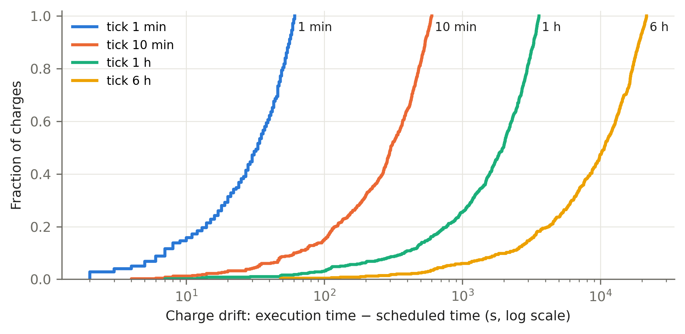
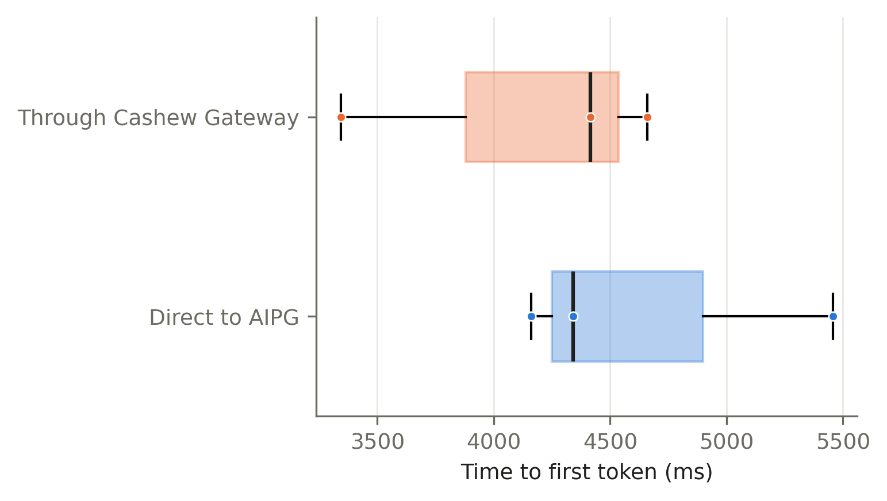

# Cashew — Results

Generated 2026-10-16T07:21:15.168Z at commit `27c6b56` (uncommitted changes present) by `sim/src/summarize.ts`.

Every number below is copied from a JSON file in this directory that a script wrote while running. Anything that could not be measured is reported as **null** with the reason.

## 1. Contract test suite

| Kind | Total | Passed | Failed |
|---|---:|---:|---:|
| Unit | 68 | 68 | 0 |
| Fuzz (1000 runs each) | 3 | 3 | 0 |
| Invariant predicates (256 runs × depth 64 = 16,384 calls) | 5 | 5 | 0 |

Invariants: `invariant_I1_noOvercharge` ✓, `invariant_I2_noChargeAfterTerminal` ✓, `invariant_I3_solvency` ✓, `invariant_I4_anchoredSchedule` ✓, `invariant_I5_ownFundsOnly` ✓.

"Keeper cannot" properties: `test_KeeperCannot_ChargeCancelled` ✓, `test_KeeperCannot_ChargeEarly` ✓, `test_KeeperCannot_ChargeTwiceInPeriod` ✓, `test_KeeperCannot_PullMoreThanPrice` ✓, `test_KeeperCannot_RedirectPayeeFunds` ✓.

Line coverage of `src/` (`forge coverage`, recorded in PROGRESS.md): 100 %.

_Source: `sim/src/test-summary.ts` at 2026-10-16T04:46:15.931Z, commit `4439796` (dirty tree)._

## 2. Gas per operation

Execution gas per call as measured by Foundry across unit tests (includes reverting calls in tests). Excludes 21,000 intrinsic + calldata gas. chargeBatch varies with batch size; see batch_sweep.json.

| Operation | Min | Avg | Median | Max |
|---|---:|---:|---:|---:|
| `createPlan` | 23,226 | 147,209 | 161,973 | 161,973 |
| `subscribeWithPermit` | 213,051 | 252,454 | 253,892 | 290,419 |
| `subscribe` | 36,446 | 204,235 | 241,640 | 241,640 |
| `charge` | 29,057 | 61,712 | 46,360 | 94,772 |
| `chargeBatch` | 27,118 | 61,279 | 49,704 | 118,593 |
| `cancel` | 23,762 | 28,689 | 30,458 | 30,498 |
| `withdraw` | 29,149 | 48,111 | 48,111 | 67,074 |
| `commitRoot` | 25,044 | 58,681 | 27,397 | 118,440 |

_Source: `sim/src/gas-report.ts` at 2026-10-16T04:46:17.519Z, commit `4439796` (dirty tree)._

## 3. Batch charging (receipt gas)

Receipt gasUsed of real transactions (includes 21,000 intrinsic + calldata). Steady state: payee and keeper claimable slots already non-zero. A single `charge()` transaction used 71,595 gas (the very first keeper charge, with a cold fee slot, used 88,695).

| Batch size | Total gas | Gas / subscriber |
|---:|---:|---:|
| 1 | 72,525 | 72,525 |
| 5 | 181,700 | 36,340 |
| 10 | 318,183 | 31,818 |
| 25 | 727,701 | 29,108 |
| 50 | 1,410,472 | 28,209 |
| 100 | 2,776,919 | 27,769 |
| 200 | 5,513,435 | 27,567 |

Per-subscriber gas falls 62.0 % from batch size 1 to 200.

_Source: `sim/src/batch-sweep.ts` at 2026-10-16T04:47:01.504Z, commit `4439796` (dirty tree)._

## 4. Cost model

Measured at run time: Base Sepolia gas price **0.006 gwei** (block 48178885); L1 data fee from the Base Sepolia GasPriceOracle.

Assumptions (not measured): ETH/USD = **3000**; Base-mainnet-like L2 gas price = **0.01 gwei** (L1 data fee excluded in that column); 20 mUSDC ≙ 20 USD.

| Operation | Gas | Base Sepolia $/subscriber | % of 20 USD cycle | Assumed mainnet L2 $/subscriber | % of cycle |
|---|---:|---:|---:|---:|---:|
| charge (single tx) | 71,595 | $1.29e-3 | 0.0064 % | $2.15e-3 | 0.0107 % |
| chargeBatch(1) | 72,525 | $1.31e-3 | 0.0065 % | $2.18e-3 | 0.0109 % |
| chargeBatch(5) | 181,700 | $6.54e-4 | 0.0033 % | $1.09e-3 | 0.0055 % |
| chargeBatch(10) | 318,183 | $5.73e-4 | 0.0029 % | $9.55e-4 | 0.0048 % |
| chargeBatch(25) | 727,701 | $5.24e-4 | 0.0026 % | $8.73e-4 | 0.0044 % |
| chargeBatch(50) | 1,410,472 | $5.08e-4 | 0.0025 % | $8.46e-4 | 0.0042 % |
| chargeBatch(100) | 2,776,919 | $5.00e-4 | 0.0025 % | $8.33e-4 | 0.0042 % |
| chargeBatch(200) | 5,513,435 | $4.96e-4 | 0.0025 % | $8.27e-4 | 0.0041 % |
| subscribeWithPermit | 274,892 | $4.95e-3 | 0.0247 % | $8.25e-3 | 0.0412 % |
| subscribe | 262,640 | $4.73e-3 | 0.0236 % | $7.88e-3 | 0.0394 % |
| cancel | 51,458 | $9.26e-4 | 0.0046 % | $1.54e-3 | 0.0077 % |
| withdraw | 69,111 | $1.24e-3 | 0.0062 % | $2.07e-3 | 0.0104 % |
| createPlan | 182,973 | $3.29e-3 | 0.0165 % | $5.49e-3 | 0.0274 % |
| commitRoot | 48,397 | $8.71e-4 | 0.0044 % | $1.45e-3 | 0.0073 % |

The keeper reward is 0.25 % of price (0.05 USD per charge). This is a transfer from the subscriber, not gas, so a keeper earns money whenever the per-subscriber gas cost is below 0.05 USD.

_Source: `sim/src/cost.ts` at 2026-10-16T04:47:42.181Z, commit `4439796` (dirty tree)._

## 5. Keeper schedule simulation

500 subscribers, 12 periods of 30 days (grace 3 days). Start times: one start per 5184.0 s slot across the first period, uniformly jittered within the slot (seed 42). Keeper txs are included 2 s after the tick.

| Tick interval | Due | Executed | Missed | Lost | Drift p50 | Drift p95 | Drift max | Keeper txs | Gas / charge |
|---:|---:|---:|---:|---:|---:|---:|---:|---:|---:|
| 60 s | 5,500 | 5,500 | 0 | 0 | 33 s | 59 s | 61 s | 5,500 | 72,534 |
| 600 s | 5,500 | 5,500 | 0 | 0 | 303 s | 570.2 s | 601 s | 5,489 | 72,444 |
| 3,600 s | 5,500 | 5,500 | 0 | 0 | 1,978 s | 3,444.1 s | 3,589 s | 5,082 | 69,096 |
| 21,600 s | 5,500 | 5,500 | 0 | 0 | 10,668.5 s | 20,336.2 s | 21,583 s | 1,320 | 38,158 |

drift = block timestamp of the charge − the nextChargeAt it settled. 'ticks' lists only ticks where something was due; ticksEmpty did no work. missed = due at a tick but not charged in that tick.

_Source: `sim/src/schedule.ts` at 2026-10-16T05:18:58.053Z, commit `4439796` (dirty tree)._

## 6. Keeper outage and restart

The real keeper process was stopped with SIGTERM (exit code 0, logged graceful shutdown: true). Chain time then advanced 546 s (3 periods; grace is 60 s) with 0 charges. After restart it recovered **60/60** missed charges in 3 txs (1.0 s wall time). Lost charges: **0**. Anchored schedule holds: **true**. Lapsed: 0.

_Source: `sim/src/outage.ts` at 2026-10-16T04:50:10.514Z, commit `4439796` (dirty tree)._

## 7. Testnet lifecycle (chain 11155111)

| Step | Status after | Entitled | Charges | Gas | Tx |
|---|---|---|---:|---:|---|
| subscribeWithPermit | Active | true | 1 | 1,169,819 | [0x4d3f5e74…](https://sepolia.etherscan.io/tx/0x4d3f5e74a18eb936f3784a1e8fc8529ebc939a3868910140dd227a938c89aaac) |
| keeper charge | Active | true | 2 | 210,352 | [0x388e2e3e…](https://sepolia.etherscan.io/tx/0x388e2e3e274fedd10fe1d6e493ea6b0a603b92c798ef5ceeefea651dc2c73f3b) |
| keeper charge | Active | true | 3 | 112,432 | [0x86da8d2b…](https://sepolia.etherscan.io/tx/0x86da8d2b350c58709dfef986a80a339c7bc33b07a8f5c4a43a34279bfe21f851) |
| keeper charge | Active | true | 4 | 112,432 | [0xf0a39e95…](https://sepolia.etherscan.io/tx/0xf0a39e9501261b41f9edb3fadf91c051be13b4c7febf35bc12e267af5b4473ce) |
| drain balance | Active | true | 4 | 128,922 | [0x89dde093…](https://sepolia.etherscan.io/tx/0x89dde093e971ea81ba63ff3bfcdbda6086c5d7c3c0e7ec9c6b0caf8263c59889) |
| keeper charge | PastDue | true | 4 | 45,160 | [0x8d4b19ef…](https://sepolia.etherscan.io/tx/0x8d4b19ef76ee0b51a3956a2aa29e183b6164bf40f08ed2b231992ae5a72f6df1) |
| top up (mint 100) | PastDue | true | 4 | 140,615 | [0x74c5d44b…](https://sepolia.etherscan.io/tx/0x74c5d44b4a7dae326d1163dffcefa09677f5c1a9acf02980388315cc4d920563) |
| keeper charge | Active | true | 5 | 112,472 | [0xdba7effd…](https://sepolia.etherscan.io/tx/0xdba7effd4ada6d30d69a59dc0b93bb943176b1448ef0ab3467ec432967441787) |
| cancel | Cancelled | true | 5 | 31,658 | [0xd6efc31e…](https://sepolia.etherscan.io/tx/0xd6efc31eebeda3ac4b89932454066351c0ad4fcdced99f7197465d0575088590) |
| after cancel (before paid-through) | Cancelled | true | 5 | null | — |
| after paid-through | Cancelled | false | 5 | null | — |

_Source: `sim/src/lifecycle.ts` at 2026-10-16T07:10:06.145Z, commit `a277c9d` (dirty tree)._

## 8. AI Power Grid snapshot

Workers online (entries in /v1/workers): **11**. set AIPG_OUR_WORKERS=<name,…> to identify our worker(s). HTTP status: workers 200, models 200.

_Source: `sim/src/grid-snapshot.ts` at 2026-10-16T07:21:13.114Z, commit `27c6b56` (dirty tree)._

## 9. Gateway latency (live AIPG)

6 live requests (3 pairs, 0 failed), `qwen3:8b`, max_tokens 64.

| Metric | Direct p50 | Direct p95 | Gateway p50 | Gateway p95 |
|---|---:|---:|---:|---:|
| TTFT (ms) | 4,341 | 5,345 | 4,415 | 4,635 |
| Total (ms) | 5,829 | 6,018 | 5,006 | 5,068 |

An earlier run (`gateway_bench_run1.json`, 24 requests) measured total latency only: direct p50 null ms, gateway p50 null ms (n=0 each). Its TTFT is **null**, because the bench then only counted `delta.content`, and qwen3 spent all 64 tokens on reasoning. The run above counts the first token of any kind. Bench requests across both runs: 30 (limit 30). AIPG did not return an `X-Grid-Job-ID` header, so `gridJobId` is null on every row.

Gateway overhead (paired, gateway − direct): TTFT p50 -818 ms, p95 205 ms. Entitlement check: uncached p50 600.16 ms (n=2), cached p50 0.01 ms (n=1).

_Source: `sim/src/bench.ts` at 2026-10-16T07:16:11.051Z, commit `27c6b56` (dirty tree)._

## 10. Usage epochs

2 epochs committed (18 rows, 2,105 tokens) on chain 11155111, gateway mode live. Inclusion proof for row 11 in epoch 5973783: `verifyRow` = **true** (proof length 3).

_Source: `sim/src/epochs.ts` at 2026-10-16T07:21:07.818Z, commit `27c6b56` (dirty tree)._

## Assumptions and caveats

- Local experiments run on anvil (chainId 31337), with time travel where stated. Gas is EVM gas, which is identical on Base and Ethereum. Fees are not.
- The public testnet deployment is Ethereum Sepolia (11155111). The cost model (section 4) still uses the measured Base Sepolia gas price, so its dollar figures describe Base.
- The Foundry gas report measures execution gas only. Receipt gas (sections 3, 5) includes intrinsic and calldata gas.
- Cost-model rows marked "assumed" depend on ETH/USD and gas-price assumptions stated in section 4.
- The gateway is a trusted metering party: an epoch root proves only what the gateway recorded.
